# OpenClaw 面试 Demo Guide

> Vibe Coding demo 主题：用 AI 加速量化研究系统的迭代，但用研究纪律、合同产物、baseline 回归和架构门禁防止“跑出来的收益”变成不可审计的幻觉。

## 30 秒介绍

OpenClaw Personal Multi-Asset Trend Allocation System 是一个受研究纪律约束的个人多资产趋势配置系统。

它不是单个回测脚本，也不是黑箱 alpha 玩具。项目重点是把量化研究流程工程化：市场数据先进入可追溯的 raw/canonical 合同，策略实验输出标准 artifact，baseline 升级必须通过回归和审计，研究结论要登记，live 调仓建议以版本化合同输出给外部 PAMS 系统。

一句话包装：

```text
我用 Vibe Coding 快速探索策略和工程实现，但把 AI 生成的研究结果关进三道门：数据合同、实验 artifact、baseline regression。
```

## 为什么适合作为 Vibe Coding Demo

| 维度 | 展示点 |
|---|---|
| 真实复杂度 | A 股趋势配置、stock+ETF 组合、baseline、研究窗口、数据质量、调仓建议 |
| AI 协作方式 | Codex 辅助实现研究面、测试、文档治理、artifact 标准化和前端工作台 |
| 工程约束 | OpenSpec、三窗口研究纪律、contract tests、architecture closure gates |
| 可复现证据 | study YAML、research journal、manifest、run_meta、execution contract |
| 产品化入口 | Vue/Vite results workbench 展示实验结果，但不重算研究口径 |
| 边界清晰 | 本仓库只输出研究结果和调仓建议，不持有账户真值，不直接下单 |

## 系统边界

```mermaid
flowchart LR
  Raw["vendor raw data"] --> Canonical["canonical market access"]
  Canonical --> Engine["engine_vector / stage_pipeline"]
  Engine --> Study["research study"]
  Study --> Artifacts["manifest / run_meta / reports"]
  Artifacts --> Baseline["baseline / audit / regression"]
  Baseline --> Package["daily_position_adjustment_package@1"]
  Package -.external contract.-> PAMS["PAMS assets/account system"]
```



核心边界：

- OpenClaw 负责研究、回测、baseline、审计和调仓建议合同。
- PAMS 负责真实账户、资产净值、通知、审批和交易生命周期。
- 本仓库不把 iFinD、TradingView、IBKR 宣传为已完成的生产接入。
- `outputs/` 是运行产物和审计证据，不是源码主路径。

## 演示路线

### 3 分钟版本

1. 打开 `README.md`，先讲项目不是普通 backtest，而是“AI 协作 + 研究纪律 + 工程治理”的研究系统。
2. 打开 `AGENTS.md`，讲最高优先级不是收益，而是可信、可审计、稳健、可解释、可复现、可回滚。
3. 打开 `research/studies/`，展示一次性研究想法如何沉淀成 study YAML。
4. 打开 `backend/research/study_runner.py`，讲 study runner 如何把研究定义转成可执行计划。
5. 打开 `tests/integration/test_schema_and_artifacts.py`，展示 artifact 合同和审计字段有测试约束。

### 8 分钟版本

1. 讲 Market Data Domain：供应商原始层、canonical 访问、数据质量状态。
2. 讲 Experiment Domain：配置编译、异步运行、job 查询、manifest、run_meta。
3. 讲 Engine Domain：向量化引擎、signal provider、stage pipeline、execution assumptions。
4. 讲 Baseline Governance：`baseline_V10.1`、`CN_STOCK_ETF_COMBO_BASELINE_V3`、三窗口研究纪律。
5. 讲 Research Study Domain：study YAML、research journal、conclusion registry、markdown report。
6. 讲 Result Workbench：前端只展示 artifact surface，不把研究口径搬到浏览器里重算。
7. 讲 Live Package Publisher：输出 `daily_position_adjustment_package@1`，但不伪装成成交事实。

## 核心目录

| 路径 | 用途 | 面试讲法 |
|---|---|---|
| `backend/api/backtest_v2` | 当前实验、artifact、配置和数据 API 表面 | API 层只暴露合同，不拥有研究真相 |
| `backend/api/shared` | API 共享响应、路径和 safe JSON | 防止 NaN/Inf 等结果污染前端 |
| `backend/core` | 数据、引擎、组合研究、审计、报告和服务层 | 真正的核心能力归属 |
| `backend/research` | study runner、研究面、诊断和实验模块 | 把研究问题转成可执行、可登记、可复查的工作流 |
| `research/studies` | study YAML | 研究定义入口 |
| `research/study_journal` | 研究轮次记录 | 记录问题、证据、结论和风险 |
| `frontend/app/results-workbench` | 研究工作台 | 展示结果，不反向污染后端协议 |
| `tests` | 合同、边界、baseline 和研究测试 | 防止 Vibe Coding 变成不可维护代码 |
| `openspec` | 规格驱动变更记录 | 高风险研究口径变化先有规格 |

## 重点演示文件

| 主题 | 文件 |
|---|---|
| 项目定位 | `README.md` |
| Agent 研究纪律 | `AGENTS.md` |
| 上线状态 | `docs/上线准备/功能特性与当前状态.md` |
| 调仓包合同 | `docs/上线准备/合同/每日调仓建议包合同.md` |
| study runner | `backend/research/study_runner.py` |
| study 定义 | `research/studies/*/*.study.yaml` |
| baseline 回归 | `backend/cli/managed/baseline_regression_check.py` |
| artifact 合同测试 | `tests/integration/test_schema_and_artifacts.py` |
| 产品定位测试 | `tests/unit/test_product_launch_positioning.py` |
| API 边界测试 | `tests/unit/test_api_compat_boundaries.py` |
| 工作台入口 | `frontend/app/results-workbench/App.vue` |

## 我们的迭代历史可以怎么讲

这套系统的 Vibe Coding 价值在于从“能跑回测”演进到“研究平台治理”：

- 将回测结果标准化为 manifest、run_meta、stage summary、execution contract。
- 把一次性研究脚本收敛到 study YAML、generated thin script 和 study runner。
- 建立 baseline regression，阻止收益更高但不可审计的改动直接升级主线。
- 用 architecture tests 固定 API owner、route 边界、PAMS 外部化边界和输出产物边界。
- 增加 results workbench，让研究结果可浏览，但前端不重算核心口径。

面试表达：

```text
我不是让 AI 直接追逐收益，而是让 AI 帮我更快地产生候选实现，再用研究纪律、合同测试和 baseline 回归筛掉不可信结果。
```

## 本地验证命令

README / demo / 文档定位相关：

```powershell
python -m pytest tests/unit/test_product_launch_positioning.py -q
python -m pytest tests/unit/test_docs_governance.py tests/unit/test_cli_main.py tests/unit/test_script_surface_governance.py -q
```

artifact 和执行合同相关：

```powershell
python -m pytest tests/integration/test_schema_and_artifacts.py -q
python -m pytest tests/unit/test_backtest_v2_artifacts.py tests/unit/test_execution_contract_goldens.py -q
```

研究工作台：

```powershell
npm install
npm run dev:results-workbench
npm run build:results-workbench
```

## Demo 边界

- 这是个人研究和工程 demo，不构成投资建议。
- 当前正式接入重点是 A 股；美股 ETF、加密、防守层资产属于规划或外部系统边界。
- iFinD、TradingView、IBKR 未作为生产真值接入。
- 本仓库不直接下单，不持有真实账户真值，不承接 PAMS app/web 的通知、审批和交易生命周期。
- baseline 变化、执行时点、信号时点、数据口径和调仓包合同都属于高风险变更，不能靠一次 prompt 直接改主线。
