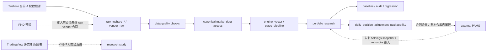

# OpenClaw Personal Multi-Asset Trend Allocation System

OpenClaw Personal Multi-Asset Trend Allocation System 是一个受研究纪律约束的个人多资产趋势配置系统。

正式英文标识：`openclaw-personal-multi-asset-trend-allocation`

当前仓库仍保留大量历史 `backtest_V2`、`pams_`、`mobile` 兼容代码和研究草稿；因此本 README 描述的是当前真实边界和上线差距，不是生产 READY 声明。

## 正式定位

本仓库的正式产品定位为：

**个人多资产趋势配置系统**

设计约束：在不加杠杆前提下，服务于可解释、可复现、可审计、可回滚的多市场趋势增强配置研究。

当前已正式接入：

- A 股

规划接入范围：

- 美股，优先 ETF
- 加密现货
- 防守层资产，包含现金、货基、短债

当前可验证能力：

- A 股市场数据同步、质量检查和统一研究口径治理
- 策略配置、实验运行、回测执行和结果产物生成
- baseline 管理、回归检查和审计
- research study、controlled experiment、diagnostic probe 管理
- 研究日志、结论登记和报告生成
- 研究工作台前端
- `daily_position_adjustment_package@1` 合同、校验和发布门禁原型

当前不得宣传为已实现的能力：

- 不作为个人资产管理或记账系统
- iFinD / TradingView / IBKR 的正式生产接入
- PAMS app/web、通知、审批、券商适配和成交回写在本仓库内端到端可用
- 本仓库直接作为个人资产管理或记账系统
- 移动端审批、approval ticket 或 `sim_account` 文件链路作为正式产品主路径

个人资产管理、账户真值、通知、审批、券商适配和成交回写应由独立 PAMS 系统承接。本仓库只输出研究结果、审计产物和版本化调仓建议合同。

## 当前系统边界

## 当前项目路径

主实现路径：

- `backend/api/backtest_v2`：当前实验、artifact、配置和数据 API 表面；名称仍处于兼容期
- `backend/api/shared`：API 共享响应、路径和兼容工具
- `backend/core`：数据、引擎、组合研究、审计、报告和服务层
- `backend/research`：study runner、研究面、诊断和实验模块
- `frontend/app/results-workbench`：研究工作台
- `research`：study YAML、研究日志和候选策略材料
- `tests`：回归、合同、边界和文档治理测试
- `openspec`：规格驱动变更记录

兼容或迁移中路径：

- `backend/api/mobile`
- `backend/api/transactions`
- `backend/core/services/mobile_*`
- `backend/core/services/transaction_lifecycle_service.py`
- `frontend/mobile.html`
- `frontend/mobile-service-worker.js`

这些路径仍存在测试和兼容用途，但不应继续作为研究平台正式主路径扩展。模拟账户服务及其自动同步入口已移除。

运行产物路径：

- `outputs`

`outputs/` 只保存实验、审计、报告和运行产物，不承接核心业务逻辑。
`outputs/` 运行产物不得反向污染源码主路径。

## 核心功能状态

| 功能域 | 当前状态 | 说明 |
|---|---|---|
| Market Data Domain | 部分落地 | A 股 Tushare raw vendor 与 canonical 访问合同可验证；iFinD 仅预留 |
| Experiment Domain | 已落地 | 回测、实验、作业、配置编译和 artifact 产物 |
| Engine Domain | 已落地 | 向量化引擎、signal provider、stage pipeline |
| Portfolio Research Domain | 已落地 | 组合研究、候选计划、调仓建议生成；不持有账户真值 |
| Baseline Governance | 已落地 | baseline 注册、回归检查、审计 |
| Research Study Domain | 已落地但仍需收敛 | study runner、研究结论、报告；大量一次性研究草稿仍需归档 |
| Result Workbench | 已落地 | 研究工作台前端，不重算核心研究口径 |
| Live Package Publisher | 合同和原型阶段 | 可生成/校验调仓包；跨 PAMS app/web/审批/执行闭环未在本仓库验证 |

不属于当前正式上线范围：

- `api.mobile`
- `mobile_*` services
- `sim_account_*` 作为账户真值
- `transaction_lifecycle_service` 作为交易生命周期主库
- 文件型 `approval_tickets`
- PAMS 语义命名的研究平台正式对象
- 一次性 shadow/AB 脚本作为产品主路径
- IBKR 或同花顺客户端自动下单

## 文档入口

本仓库只保留这一份 `README.md` 作为说明入口。`docs/`、`backend/`、`openspec/`、`research/` 等子目录不再放各级 README；具体材料通过中文文件名、OpenSpec 规格和治理测试直接进入。

| 文档类型 | 入口 |
|---|---|
| 人读说明 | `docs/03_策略说明/*`、`docs/上线准备/*.md` |
| 合同/准机器文档 | `docs/01_系统接口模块定义/产物协议/*`、`docs/02_系统架构设计/数据库/*合同.md`、`docs/上线准备/合同/*` |
| 机器执行材料 | `docs/02_系统架构设计/数据库/*.sql`、`docs/02_系统架构设计/**/*运行手册.md` |
| 研究记录 | `docs/05_研究记录/因子研究登记.md`、`research/studies/*`、`research/study_journal/*` |
| 历史/重构材料 | `docs/04_重构思路/*` |

文档治理入口：

- `docs/文档治理.md`
- `docs/05_研究记录/因子研究登记.md`

脚本与 CLI 入口治理：

- 正式 CLI 入口统一使用 `python -m backend.cli`。
- 托管命令实现放在 `backend/cli/managed/`。
- study 的脚本式入口只允许使用 `backend/scripts/generated/run_<study_id>.py`，且必须对应 `research/studies/*.study.yaml`。
- `backend/scripts/archive/` 只作为历史归档目录，不再放 README 入口，不承接 active study。
- `backend/scripts` 顶层只保留被 `backend/scripts/inventory.json` 显式登记的 legacy command implementation。
- `backend/core/cli/` 仅作为 compatibility-only 旧入口，不接收新的命令逻辑。

上线准备文档包：

- `docs/上线准备/功能特性与当前状态.md`
- `docs/上线准备/架构与当前调用边界.md`
- `docs/上线准备/模块归属与上线差距.md`
- `docs/上线准备/正式命名与废弃计划.md`
- `docs/上线准备/上线差距清单.md`

函数级静态分析产物：

- `outputs/architecture_audit/20260530_function_call_inventory/feature_convergence_report.md`

## 开发纪律

所有影响研究口径、baseline、执行时点、成交时点、数据口径、API 主输出结构、调仓包合同的变更，必须先通过 OpenSpec 规格评审。

标记生产上线前必须满足：

- 没有未说明的研究口径变化
- 没有 API route 双定义
- 没有 API 层调用另一个 API route 函数
- 没有 PAMS/移动端/账户真值混入研究平台正式主路径
- 没有运行产物反向污染源码主路径
- iFinD、TradingView、IBKR 只在完成合同、测试和回退方案后进入正式能力
- PAMS 跨仓库接收、展示、审批、交易生命周期 dry-run 可复现
- 工作区和 CI 处于可审计状态
