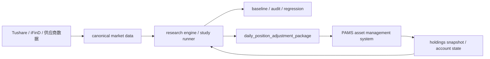

# OpenClaw Personal Multi-Asset Trend Allocation System

OpenClaw Personal Multi-Asset Trend Allocation System 是一个受研究纪律约束的个人多资产趋势配置系统。

本系统的核心目标不是提供个人资产记账、券商交易、移动端审批或账户管理真值，而是在不加杠杆前提下，提供可解释、可复现、可审计、可回滚的多市场趋势增强配置研究与 live 调仓建议生成能力。

## 正式定位

本仓库的正式产品定位为：

**个人多资产趋势配置系统**

当前已正式接入：

- A 股

规划接入范围：

- 美股，优先 ETF
- 加密现货
- 防守层资产，包含现金、货基、短债

正式能力范围：

- 市场数据接入、同步、质量检查和统一研究口径
- 策略配置、实验运行、回测执行和结果产物生成
- baseline 管理、回归检查和审计
- research study、controlled experiment、diagnostic probe 管理
- 研究日志、结论登记和报告生成
- 研究工作台前端
- live strategy 调仓包生成

明确非目标：

- 不作为个人资产管理或记账系统
- 不持有账户、现金、持仓和交易生命周期真值
- 不直接连接券商执行实盘下单
- 不把移动端审批、approval ticket 或 `sim_account` 文件链路作为正式产品主路径
- 不把 `outputs/` 运行产物当作源码或长期跨系统接口

个人资产管理、账户真值、通知、审批、券商适配和成交回写应由 PAMS 系统承接。

## 系统边界

## 正式主路径

源码主路径：

- `backend/api`
- `backend/core`
- `backend/research`
- `frontend`
- `research`
- `tests`
- `openspec`

运行产物路径：

- `outputs`

`outputs/` 只保存实验、审计、报告和运行产物，不承接核心业务逻辑。

## 核心功能

| 功能域 | 正式状态 | 说明 |
|---|---|---|
| Market Data Domain | 正式 | 供应商原始数据进入统一研究数据口径 |
| Experiment Domain | 正式 | 回测、实验、作业、配置编译 |
| Engine Domain | 正式 | 向量化引擎、信号 provider、stage pipeline |
| Portfolio Research Domain | 正式 | 组合构建、候选计划、调仓建议生成 |
| Baseline Governance | 正式 | baseline 注册、回归检查、审计 |
| Research Study Domain | 正式 | study runner、研究结论、报告 |
| Result Workbench | 正式 | 研究工作台前端 |
| Live Package Publisher | 目标正式能力 | 只生成调仓包，不执行交易 |

不属于正式上线范围：

- `api.mobile`
- `mobile_*` services
- `sim_account_*` 作为账户真值
- `transaction_lifecycle_service` 作为交易生命周期主库
- 文件型 `approval_tickets`
- PAMS 语义命名的研究平台正式对象
- 一次性 shadow/AB 脚本作为产品主路径

## 文档入口

正式上线文档包：

- `docs/product_launch/README.md`
- `docs/product_launch/FEATURES.md`
- `docs/product_launch/ARCHITECTURE.md`
- `docs/product_launch/MODULE_OWNERSHIP.md`
- `docs/product_launch/NAMING_AND_DEPRECATION.md`
- `docs/product_launch/RELEASE_CHECKLIST.md`

函数级静态分析产物：

- `outputs/architecture_audit/20260530_function_call_inventory/feature_convergence_report.md`

## 开发纪律

所有影响研究口径、baseline、执行时点、成交时点、数据口径、API 主输出结构、调仓包合同的变更，必须先通过 OpenSpec 规格评审。

正式上线前必须满足：

- 没有未说明的研究口径变化
- 没有 API route 双定义
- 没有 API 层调用另一个 API route 函数
- 没有 PAMS/移动端/账户真值混入研究平台正式主路径
- 没有运行产物反向污染源码主路径
- 有回归测试、schema 校验和回退方案
