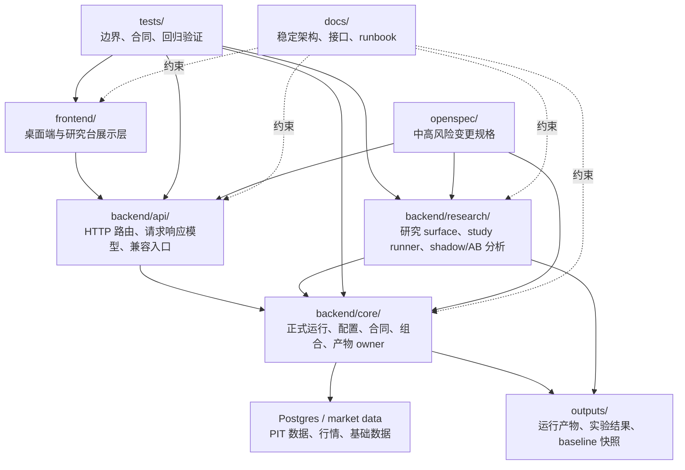

# 架构地图与边界规则

## 0. 文档定位

本文档是当前仓库的“架构地图 + 边界规则”总表，用于约束后续清理、迁移、研究实现和问题排查。

它只回答三个问题：

- 当前哪些目录是正式 owner。
- 模块之间允许怎么依赖。
- 哪些现存反向依赖只是过渡债务，不能继续扩大。

本文档不替代 `AGENTS.md`。当边界判断与收益改进冲突时，仍以可信、可审计、可复现、可回滚优先。

## 1. 当前架构地图



主运行方向是：

`frontend -> backend/api -> backend/core -> outputs / database`

研究方向是：

`research/study definition -> backend/research -> backend/core -> outputs/studies or outputs/experiments`

禁止把方向反过来，例如 `backend/core` 不能把 `backend/api` 当基础设施 owner。

## 2. 目录职责

| 路径 | 当前职责 | 可以拥有 | 不应拥有 |
| --- | --- | --- | --- |
| `frontend/` | 桌面端、研究台、可视化、交互状态 | 页面状态、展示编排、API 调用、轻量 UI 适配 | 回测逻辑、核心研究计算、baseline 真相、产物协议真相 |
| `backend/api/` | HTTP 适配层、请求响应模型、路由、旧入口兼容 | FastAPI route、Pydantic 请求响应、API-only 兼容壳 | core/research 共用 helper 的正式实现、回测主逻辑、产物合同 owner |
| `backend/core/` | 正式运行主干与合同 owner | runtime、portfolio、stage pipeline、config、contracts、artifact output owner、shared helper | HTTP 语义、前端展示语义、研究过程叙事 |
| `backend/research/` | 研究 surface 与 study 编排 | shadow/AB 分析、snapshot study、研究结论产物生成 | 正式交易口径真相、API route、长期业务逻辑 owner |
| `research/` | study YAML、研究配置入口 | study definition、variant/window 声明 | Python 核心业务逻辑 |
| `tests/` | 合同、边界、回归验证 | 边界扫描、golden、integration regression | 生产逻辑 |
| `openspec/` | L2/L3 变更规格 | proposal/design/spec/tasks | 运行产物、实现代码 |
| `docs/` | 稳定架构与接口文档 | 当前正式边界、runbook、schema | 临时实验结论真相 |
| `outputs/` | 运行产物 | experiments、baselines、studies、logs、replay anchors | 源码主路径、正式实现、核心业务逻辑 |

## 3. 依赖方向规则

### 3.1 API 层

API 层可以：

- 调用 `backend.core` 的 service、contract、shared helper。
- 暴露 HTTP route。
- 保留旧 import path 的兼容 re-export。
- 做请求参数解析、响应整理和错误码转换。

API 层不应该：

- 成为 `backend/core` 或 `backend/research` 复用 helper 的正式 owner。
- 保存 artifact schema、execution contract、manifest、path/json helper 的唯一实现。
- 在 route 中重算核心研究逻辑。

兼容 re-export 的判断标准：

- 文件体量应很薄。
- 只 import core owner 并导出旧名称。
- 不应继续沉淀新业务逻辑。

### 3.2 Core 层

Core 层可以：

- 拥有正式运行逻辑。
- 拥有跨 API/research 复用的 shared helper。
- 拥有 artifact 协议、execution contract、manifest、run profile、experiment index 等非 HTTP 合同。
- 读写正式运行所需的 `outputs/experiments` 与 baseline 产物。

Core 层不应该：

- 从 `backend.api.shared.*` 导入基础工具。
- 从 `backend.api.backtest_v2.protocol` 导入 artifact 协议。
- 从 `backend.api.backtest_v2.artifacts_manifest`、`artifacts_io`、`artifacts_stage_summary`、`runner_output_helpers` 导入非 HTTP helper。
- 依赖 API route、HTTP request/response 或展示字段。

### 3.3 Research 层

Research 层可以：

- 调用 core service 或 core data access。
- 生成研究-only 的 machine/human outputs。
- 通过 study YAML 控制窗口、variant、输入快照和输出要求。
- 对已生成的 experiment artifact 做审计和归因。

Research 层不应该：

- 绕过正式 runtime 直接改 baseline 口径。
- 把 `outputs/` 里的历史产物当源码模块复用。
- 在没有 OpenSpec 的情况下改变信号时点、成交时点、股票池、ETF 池、排序主因子、组合构建或防守层定义。

### 3.4 Frontend 层

Frontend 层可以：

- 展示研究台、实验结果、study journal、baseline 状态。
- 发起 API 调用。
- 做分页、筛选、布局、轻量格式化。

Frontend 层不应该：

- 重新计算 NAV、绩效指标、交易规则或研究结论。
- 用 UI 字段反向覆盖 backend artifact schema。
- 把展示便利字段当成正式合同字段。

## 4. 当前正式 owner 表

| 能力 | 正式 owner | 兼容入口 |
| --- | --- | --- |
| JSON 清洗、hash、安全读取 | `backend.core.shared.json_utils` | `backend.api.shared.json_utils` |
| repo/results/config/path helper | `backend.core.shared.paths` | `backend.api.shared.paths` |
| artifact 协议常量与 counter normalization | `backend.core.contracts.artifacts` | `backend.api.backtest_v2.protocol` |
| artifact IO coercion / rel path / canonical CSV | `backend.core.shared.artifact_io` | `backend.api.backtest_v2.artifacts_io` |
| manifest 写入、manifest schema、stage summary extract | `backend.core.services.experiment_manifest_service` | `backend.api.backtest_v2.artifacts_manifest`、`backend.api.backtest_v2.artifacts_stage_summary` |
| execution contract snapshot、run profile summary、config snapshot | `backend.core.services.experiment_output_helpers` | `backend.api.backtest_v2.runner_output_helpers` |
| experiment index append | `backend.core.services.experiment_index_service` | `backend.api.backtest_v2.artifacts_finalize._append_to_experiment_index` |
| artifact finalize / diagnostics | `backend.core.services.experiment_artifacts_finalize`、`backend.core.services.experiment_artifacts_diagnostics` | `backend.api.backtest_v2.artifacts_finalize`、`backend.api.backtest_v2.artifacts_diagnostics`、`backend.api.backtest_v2.artifacts_impl` |
| artifact finalize helper primitives | `backend.core.services.experiment_artifacts_finalize_helpers` | `backend.core.services.experiment_artifacts_finalize` |
| backtest data surface helpers | `backend.core.services.backtest_data_surface_helpers` | `backend.api.backtest_v2.data_impl` |
| public run validation / response / ETA | `backend.core.services.experiment_public_run_surface` | `backend.api.backtest_v2.runner_impl` |
| semantic config schema / compiler | `backend.core.config.semantic_config_schema`、`backend.core.config.semantic_config_compiler` | `backend.api.backtest_v2.semantic_config_schema`、`backend.api.backtest_v2.semantic_config_compiler` |
| builtin config library | `backend.core.config.builtin_config_library` | `backend.api.backtest_v2.builtin_config_library` |
| experiment query DTO / surface contract | `backend.core.contracts.manifest`、`backend.core.contracts.responses`、`backend.core.contracts.surface` | `backend.api.backtest_v2.contracts.manifest`、`backend.api.backtest_v2.contracts.responses`、`backend.api.backtest_v2.contracts.surface` |
| runtime config compile helpers | `backend.core.config.runtime_config_bundle`、`backend.core.config.runtime_config_helpers`、`backend.core.config.runtime_config_base`、`backend.core.config.runtime_config_signal`、`backend.core.config.runtime_config_risk_exit`、`backend.core.config.runtime_config_asset`、`backend.core.config.runtime_config_universe`、`backend.core.config.execution_overrides` | `backend.api.backtest_v2.runner_config_*`、`backend.api.backtest_v2.execution_overrides` |
| study definition / loader / request builder / standard reports | `backend.core.studies` | `backend.research.study_definition`、`backend.research.study_loader`、`backend.research.study_reports` |
| internal runtime experiment request | `backend.core.contracts.requests.BacktestV2ExperimentRequest` | `backend.api.backtest_v2.runner_impl.BacktestV2ExperimentRequest` |
| locked candidate runtime execution | `backend.core.services.locked_candidate_runtime_service` | `backend.api.backtest_v2.runner_impl._run_locked_candidate_preset_sync` |
| study journal | `backend.research.study_journal` + API facade | 无 |
| study runner | `backend.research.study_runner` | generated thin scripts |
| baseline access | `backend.core.tools.baseline_access` | API config/baseline facade |

判断原则：

- 表中“正式 owner”只能有一个。
- 兼容入口可以存在，但不能继续长出独立实现。
- 新代码优先 import 正式 owner。

## 5. 现存过渡债务

以下依赖是当前仍存在的过渡状态，不代表新代码可以继续照抄。

| 位置 | 现状 | 后续处理方向 |
| --- | --- | --- |
| `backend.core.config.runtime_config_bundle` -> `backend.research.study_loader` / `study_runner` | 已清理。core 通过 `backend.core.studies` 读取 study 定义并构建 request payload | 保持 `backend/core` 不得直接依赖 `backend.research`，由 `tests/unit/test_shared_helper_boundary.py` 守门 |

规则：

- 过渡债务可以被调用，但不得新增同类依赖。
- 每清理一类债务，都要补边界测试。
- 不为了减少行数一次性搬大文件，必须先确定 owner，再迁移。

## 6. 禁止模式

以下模式直接判定为架构偏移：

- `backend/core` 新增对 `backend.api.shared.*` 的依赖。
- `backend/core` 新增对 API artifact helper 的依赖，尤其是 `artifacts_io`、`artifacts_manifest`、`runner_output_helpers`。
- `backend/core` 新增对 `backend.api.backtest_v2.semantic_config_compiler` 或 `semantic_config_schema` 的依赖。
- `backend/core` 新增对 `backend.api.backtest_v2.contracts.manifest`、`responses` 或 `surface` 的依赖。
- `backend/core` 或 `backend/research` 新增任何 `backend.api.*` 直接依赖。
- `backend/research` 绕过 study runner，把策略实验逻辑写进 `outputs/` 或临时脚本。
- `frontend` 重新实现 backend 已有的指标、调度、回测或审计计算。
- API route 里直接拼装正式 execution contract 的核心逻辑。
- 一个文件既做 HTTP request 解析，又做 runtime 执行，又写 artifact，又生成研究结论。
- 为了兼容旧路径而复制一份实现，而不是 re-export 正式 owner。

## 7. 新代码落点判断

新增代码前先问四个问题：

1. 是否有 HTTP 语义？
   - 有：优先 `backend/api`。
   - 没有：不要放 API 层。

2. 是否会被正式 runtime、API、research 多方复用？
   - 会：优先 `backend/core/shared`、`backend/core/contracts` 或 `backend/core/services`。

3. 是否只用于某轮研究分析？
   - 是：优先 `backend/research`，输出进入 `outputs/studies`。

4. 是否改变交易口径、资产池、信号、成交、组合构建或 baseline 行为？
   - 是：按 L3，先 OpenSpec，再实现。

简化判断：

| 新内容 | 默认落点 |
| --- | --- |
| HTTP route / API request / API response | `backend/api` |
| 非 HTTP 合同、schema、artifact helper | `backend/core/contracts` 或 `backend/core/services` |
| JSON/path/IO 基础工具 | `backend/core/shared` |
| 正式 runtime 逻辑 | `backend/core` |
| 研究-only 分析 | `backend/research` |
| study 配置 | `research/studies` |
| 页面展示 | `frontend` |
| 文档 | `docs` |
| 运行结果 | `outputs` |

## 8. 验收规则

架构清理类改动至少要跑：

```powershell
pytest tests\unit\test_shared_helper_boundary.py -q
pytest tests\unit\test_api_compat_boundaries.py -q
pytest tests\unit\test_architecture_docs.py -q
pytest -q --collect-only
```

若改到 artifact / manifest / execution contract，还要跑：

```powershell
pytest tests\unit\test_backtest_v2_artifacts.py tests\unit\test_artifacts_finalize_regime_meta.py -q
pytest tests\integration\test_backtest_v2_experiment_artifacts.py tests\integration\test_schema_and_artifacts.py -q
```

若改到 OpenSpec change：

```powershell
openspec validate <change-id> --strict
```

是否需要 Docker：

- 只改文档、边界测试、re-export owner：通常不需要。
- 改 runtime 行为、配置编译、study runner、baseline、交易口径：需要 Docker 验证。

## 9. 下一阶段清理顺序

建议顺序：

1. 归档已经完成的架构 cleanup changes，降低 OpenSpec 噪音。
2. 拆分 `backend.core.services.experiment_artifacts_finalize`，按 perf/nav/run_meta/audit/regime/attribution writer 分 owner。
3. 拆分 `backend.core.services.cn_stock_etf_unified_runtime_service`，把组件输入解析、组合 NAV、预算 runtime、artifact 输出分离。

不建议：

- 为了“行数减少”直接合并所有文件。
- 为了“目录好看”把没有 owner 共识的逻辑搬来搬去。
- 一次性清掉所有 API 反向依赖，导致行为差异不可归因。
