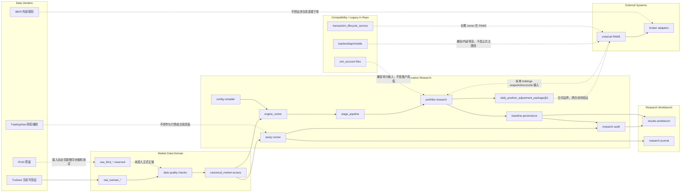

# 架构与当前调用边界

## 1. 架构目标

OpenClaw Personal Multi-Asset Trend Allocation System 的目标架构服务于“个人多资产趋势配置系统”，不把研究平台能力外推为资产管理或交易执行系统。

目标能力：

- 数据可追溯
- 实验可复现
- 策略可审计
- baseline 可回滚
- 研究和资产管理解耦
- live 调仓建议可发布但不可直接成交

当前状态：A 股研究主链、Tushare raw vendor、canonical market access、baseline 审计、研究工作台和调仓包合同可在本仓库内验证；iFinD、TradingView、IBKR 和 PAMS app/web/审批/券商闭环尚未在本仓库内完成。

## 2. 当前系统调用图

## 3. 当前主实现路径

| 路径 | 当前角色 |
|---|---|
| `backend/api/backtest_v2` | 当前实验、artifact、配置和数据 API 表面；名称处于兼容期 |
| `backend/api/shared` | API 共享响应、路径和兼容工具 |
| `backend/core/data` | 市场数据访问和 PG 映射 |
| `backend/core/engine_vector` | 研究引擎核心 |
| `backend/core/stage_pipeline` | stage 合同和 adapter |
| `backend/core/portfolio` | portfolio research 和 candidate plan |
| `backend/core/services` | 编排服务；其中 mobile/sim/transaction 服务为兼容遗留 |
| `backend/research` | study、formal surface、diagnostic probe、controlled experiment |
| `frontend/app/results-workbench` | 正式研究工作台 |
| `research` | study YAML、journal、候选策略材料 |
| `tests` | 合同、回归、边界和文档治理测试 |
| `openspec` | 规格驱动变更记录 |

## 4. 分层规则

### API Layer

职责：

- HTTP 请求校验
- DTO 转换
- 权限与参数校验
- 调用 application service
- 返回稳定 schema

禁止：

- 实现策略逻辑
- 直接持有 DB/env 细节
- 一个 API route 函数调用另一个 API route 函数
- route decorator 同时存在于 route 层和 impl 层

### Application Service Layer

职责：

- 实验运行编排
- artifact 编排
- market data sync 编排
- baseline 查询和审计编排
- live package 发布编排

禁止：

- 将移动端审批和交易生命周期扩展为正式主路径
- 将 PAMS 账户真值复制到研究平台

### Core Research Layer

职责：

- engine runtime
- signal provider
- stage pipeline
- candidate plan
- portfolio research
- risk/exit research

禁止：

- 直接写前端展示结构
- 直接调用 PAMS、IBKR 或券商接口
- 直接写交易生命周期真值

### Research Study Layer

职责：

- formal research surface
- controlled experiment
- diagnostic probe
- archived study

禁止：

- 一次性 study 自动进入产品主路径
- research-only 结果自动进入 live 发布

### Product UI Layer

职责：

- 展示实验、baseline、study、artifact、journal
- 查询 API
- 只做展示级派生

禁止：

- 重算研究口径
- 修正后端数据
- 推导交易建议

## 5. 与 PAMS 的边界

研究平台输出：

- `daily_position_adjustment_package@1`
- research audit report
- baseline metadata
- holdings-aware reconcile 派生结果

PAMS 应负责：

- package 接收和幂等
- app/web 通知
- 用户审批
- broker adapter
- 订单、成交、拒绝、撤销状态
- 账户、现金、持仓真值

当前未完成项：跨仓库 PAMS 接收、入库、展示、通知、审批和交易生命周期 dry-run 尚未在当前仓库验证，不得标记为已上线。
