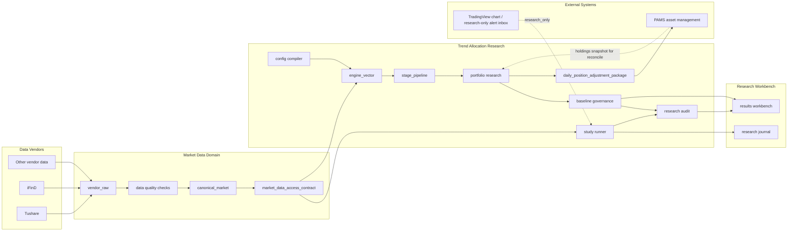

# 正式产品架构

## 1. 架构目标

OpenClaw Personal Multi-Asset Trend Allocation System 的正式上线架构必须支持：

本架构服务于“个人多资产趋势配置系统”，不把研究平台能力外推为资产管理或交易执行系统。

- 数据可追溯
- 实验可复现
- 策略可审计
- baseline 可回滚
- 研究和资产管理解耦
- live 调仓建议可发布但不可直接成交

## 2. 正式系统调用图

## 3. 正式分层

### API Layer

职责：

- HTTP 请求校验
- DTO 转换
- 权限与参数校验
- 调用 application service
- 返回稳定 schema

禁止：

- 实现策略逻辑
- 直接持有 DB/env 细节
- 一个 API route 函数调用另一个 API route 函数
- route decorator 同时存在于 route 层和 impl 层

### Application Service Layer

职责：

- 实验运行编排
- artifact 编排
- market data sync 编排
- baseline 查询和审计编排
- live package 发布编排

禁止：

- 将移动端审批和交易生命周期扩展为正式主路径
- 将 PAMS 账户真值复制到研究平台

### Core Research Layer

职责：

- engine runtime
- signal provider
- stage pipeline
- candidate plan
- portfolio research
- risk/exit research

禁止：

- 直接写前端展示结构
- 直接调用 PAMS、IBKR 或券商接口
- 直接写交易生命周期真值

### Research Study Layer

职责：

- formal research surface
- controlled experiment
- diagnostic probe
- archived study

禁止：

- 一次性 study 自动进入产品主路径
- research-only 结果自动进入 live 发布

### Product UI Layer

职责：

- 展示实验、baseline、study、artifact、journal
- 查询 API
- 只做展示级派生

禁止：

- 重算研究口径
- 修正后端数据
- 推导交易建议

## 4. 与 PAMS 的边界

研究平台输出：

- `daily_position_adjustment_package@1`
- research audit report
- baseline metadata
- holdings-aware reconcile 派生结果

PAMS 输入并负责：

- package 接收和幂等
- app/web 通知
- 用户审批
- broker adapter
- 订单、成交、拒绝、撤销状态
- 账户、现金、持仓真值

研究平台不得直接接券商执行。
